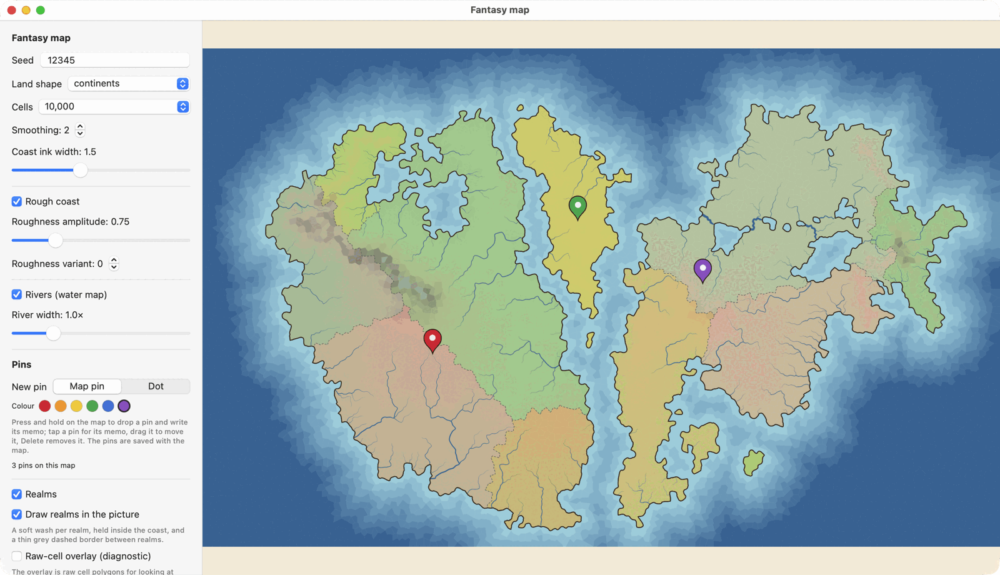

# Fantasy-Map-Generator-Swift

An **unofficial Swift port** of the ideas and algorithms of
[Azgaar's Fantasy Map Generator](https://github.com/Azgaar/Fantasy-Map-Generator), for Swift apps on Apple platforms
rather than for a browser: generate a fantasy map from a seed and a few settings, show it in SwiftUI, save and load it.

**Status: the land and the water chain (temperature, precipitation, rivers) are built and compared with the original's own output, and realms are built as this port's own growth over the cells (see `docs/design-realms.md`); the map can be drawn (height picture, inked and smoothed coast, rivers, realm wash and borders), saved, zoomed and panned, and carries pins with memos.** Not built yet: biomes, cultures, religions, towns, routes, labels and symbols. The design is in
[docs/design.md](docs/design.md); each plan is in `docs/plans/` and each built stage has a note in `docs/steps/`.

`LandMap.generate(...)` makes a land map as the original's pipeline does for the land: the seeded grid points, the
Voronoi cells, one of the fourteen land templates' heights, the features (island, ocean and lake) with each cell's distance
from the coast, and the lakes that change heights and coasts. `encoded()` saves it and `LandMap(decoding:)` loads it,
identical to what was saved. Each stage was compared with the original's own output (see `docs/steps/`).

**Drawing:** a second library target, `FantasyMapKit`, draws a map and shows it in SwiftUI (`FantasyMapView`, with zoom, pan and pins; `MapImage` renders a bitmap or PNG). It draws the height picture, the inked and optionally roughened coast, rivers, and the realms as a soft wash with thin dashed borders. `MapSettings` and `MapControls` are one value and one view for everything that makes and shows a map (the seed, land shape, realms, pins and more), with `change(from:)` saying how much work a change takes; `PinNote` is the note for a pin ([programming guide](docs/programming-guide.md#controls-settings-and-the-pin-note)). The core does not depend on it. No symbols or labels yet (see `docs/design-drawing.md`). Example pictures: [height only](docs/images/height-continents.png), [coast inked](docs/images/coast-continents.png), [coast smoothed](docs/images/coast-smooth-continents.png).

Using the libraries in your own app: [docs/programming-guide.md](docs/programming-guide.md).

## Try it

    swift run -c release FantasyMapDemo

opens a small SwiftUI window (macOS) with **all the map's controls in one box** (`MapControls`, the same view an app can use): the seed and land shape, the number of cells, the coast, the rivers, the realms and the pins. It also has an optional **diagnostic realms overlay** (territories, seeds and crossing links drawn on the raw cells; not the final territory drawing) and buttons to save the picture (PNG) and the map (the package's JSON). Release mode is much faster than debug for large maps. It is a demo target that uses the two libraries; the libraries do not use it, and apps use them directly (`FantasyMapCore` for the data, `FantasyMapKit` for the picture). A SwiftPM executable is not an app bundle, so the window has no custom icon and menus are minimal.

## Thanks

Thank you, Max Haniyeu (Azgaar). This package exists because [Fantasy Map Generator](https://github.com/Azgaar/Fantasy-Map-Generator) is so good: it turns a seed into a believable map, it is open, and it lets anyone use the maps they make. Its pipeline and algorithms are the reference this port follows and is compared with, number for number, and it has been a joy to learn from. What works here comes from that work; any mistakes are this port's own. If you like what you see here, please try the original too.

## Credit

The original generator and its algorithms are the work of Max Haniyeu (Azgaar), under the MIT licence. This package
is independent and not endorsed by him. See [ACKNOWLEDGEMENTS.md](ACKNOWLEDGEMENTS.md) for the full licence text.
The Swift code is © Kaz Yoshikawa, under the MIT licence (see [LICENSE](LICENSE)). The original's added paragraph, that maps made with it are free to use, is kept in ACKNOWLEDGEMENTS.md.
