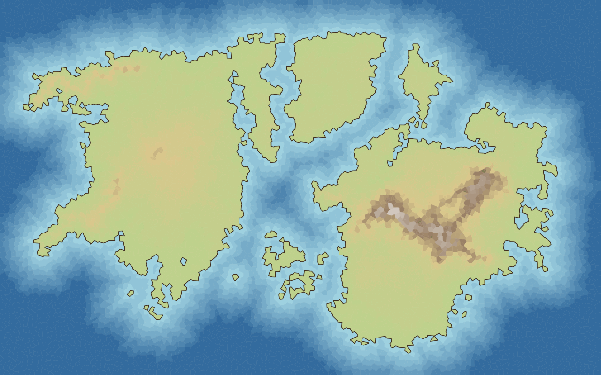

# Drawing stage 2a: the coast as the cells give it (unsmoothed)

Status: built 2026-10-20, topology checks added after review. Design: [design-drawing.md](../design-drawing.md), stage 2.

## What was built

- **`CoastOutlines`** (`Sources/FantasyMapKit/CoastOutlines.swift`): from a `LandMap` it makes
  - `landRings`: closed polygons that together are the land, compound (islands are outer rings, lakes and closed-off bays holes, one land mass can be several rings), each with **land on its left** (outer rings positive signed area, holes negative). A land mass that meets the frame is closed along the frame; **those closing segments are part of the fill, not coastline.**
  - `ink`: only land–water boundaries, as open lines that begin and end on the frame, or closed lines inside it. **Nothing runs along the frame.**
- **Source of the geometry:** the current cells' Voronoi edges between a land cell and a water cell (height ≥ 20 is land), directed so land is on the left and chained through the Voronoi vertices. Not the feature records (so retained records with no cells are ignored, and a lake is a hole because its cells are water) and **not the stage-1 ray-extended polygons.**
- **At the frame:** a coast ends at a Voronoi vertex that can lie inside the rectangle (the boundary pseudo-points cut border cells short). Such an end is continued along its last edge to the frame; if that would run further than three spacings it goes to the nearest frame point. Ends outside the rectangle are clipped (Liang–Barsky), with the cut end placed exactly on the frame. Fill rings are closed by walking the frame with the rectangle on the left from each coast's end to the next coast's start. If no coast reaches the frame, the frame's cells are all land (one rectangle ring) or all water (none).
- **Style and drawing:** `MapStyle` gained `ink` (colour) and `inkWidth` in **map units** (0 turns the coastline off). `MapDrawing` carries `coast` and `ink` commands; the image renderer and the SwiftUI view stroke them over the stage-1 fills (round joins and caps, clipped to the map). **The fills are still stage 1's per-cell polygons**; replacing them with "land colours clipped to the land rings" belongs with 2b, where the outline stops matching the cells.

## Tests (`CoastOutlinesTests`, 14)

On six generated maps (800 cells, 400×300): every cell site lies inside the land rings exactly when the cell is land (sites on the frame nudged a millionth inward, because a point on an edge says nothing under even-odd); rings are closed, inside the rectangle, with positive total area below the map's; total ring area equals the land cells' clipped area up to the frame slivers; **every ink segment separates land (left) from water (right)**, none lies along the frame, open lines begin and end on the frame; an all-land map gives one rectangle and no ink, an all-water map nothing; closed ink loops include both lakes (holes) and islands across ten seeds; same map gives identical outlines, and a saved-and-loaded map the same as the original; ink is switched off by width 0 or a transparent colour.

## Topology checks added after review

- **Frame closure is verified, not assumed.** `rings(from:)` pairs each coast end with the next coast start going round the frame; it now checks that the pairing is a permutation (every start has exactly one predecessor) and that every walk returns to its own first piece. The result is exposed as `frameClosureIsConsistent`; **false means the rings are not to be trusted** (for example two coasts crossing at the frame) instead of being closed anyway. True on every map tested.
- **No crossings:** a test counts proper crossings between non-adjacent segments of each ring (the closing edge included) and between different rings, on the six generated maps and the constructed one below: zero. (Only strict crossings are counted; touching at a shared point is not.)
- **A constructed pattern with several coasts meeting the frame** ([picture](../images/coast-channel.png), 400×300, 3,000 cells): two land strips running off the left and right of the frame, a water channel between them, a lake in the lower strip and an island in the channel. Two open ink lines from frame to frame, two closed loops (hole negative, island positive), four rings (three positive, one negative); points on the frame at both strips are land, in the channel water; nothing is inked along the frame. Looked at by eye: the ink meets the left and right frame cleanly.
- **Continuation policy** (the three-spacing cap and nearest-frame fallback are drawing policies, not recovered map geometry): channels of 60, 30, 6 and 4 map units on 800- and 3,000-cell grids all close consistently with no crossings; channels wider than two spacings give two strips; narrower than a cell the water is only scattered cells, so one land mass with holes, which is the cells' own answer.
- **Not claimed yet:** fill/ink alignment at the frame. Fills are still stage 1's per-cell polygons, so 2b must resolve that (land clipped to the rings) before smoothing is presented as finished rendering. Simple raw rings do not guarantee simple smoothed curves; 2b tests holes and narrow channels after smoothing.

## Measured

Release, one run, continents template at 100,000 cells: **233 rings and 238 ink lines in 33 ms** (debug 0.6 s). Evidence only; one machine, one map.

## Limits, stated

- The continuation of two coasts at the frame could in principle cross each other; the closure check and the crossing test found none on the maps tried. Evidence, not proof.
- Two cells at identical points (degenerate Voronoi vertices) could make an edge be skipped; not seen.
- The line is still the mesh's staircase; smoothing is 2b and roughening 2c.
- Looked at by eye on two maps (continents, archipelago): the ink follows the cell coasts, lakes and small islands are inked as separate loops. Neither picture touches the frame much, so the frame case is covered by tests, not by that look.
