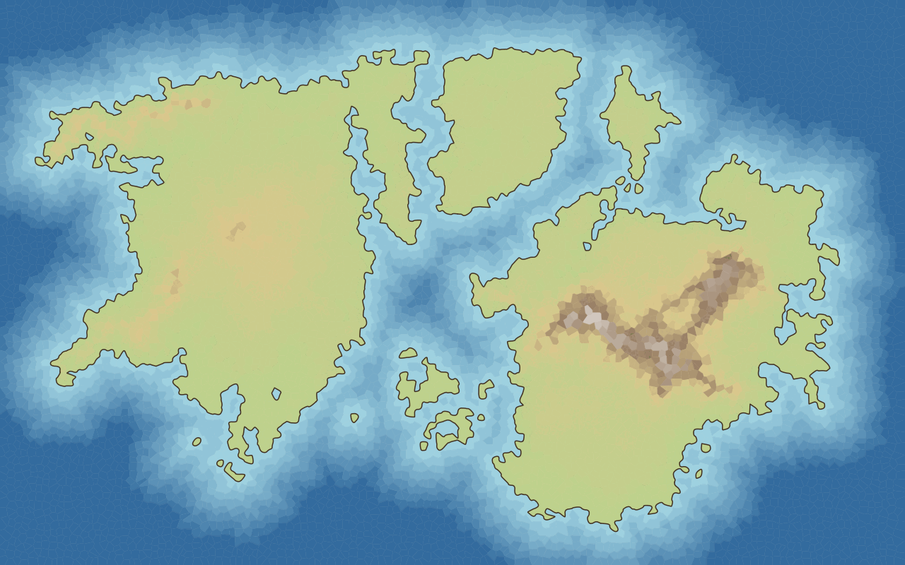
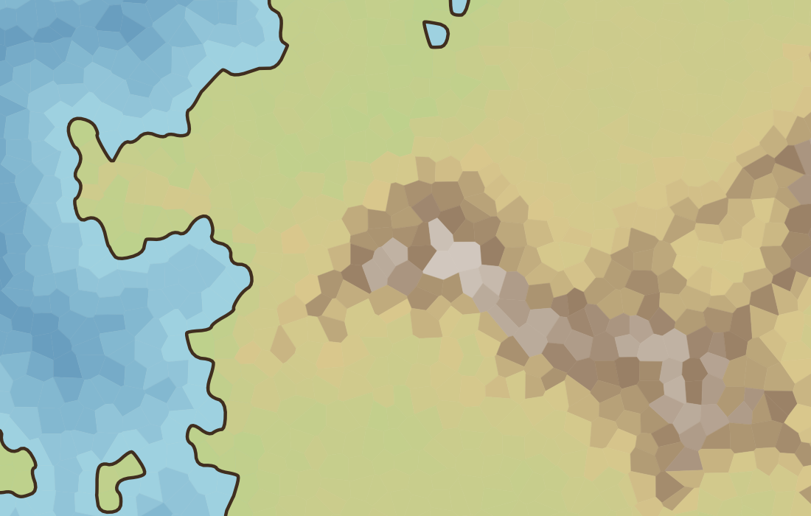

# Drawing stage 2b: smoothing and aligned fills

Status: built 2026-10-20; review corrections applied (two-sided coverage, stricter test, coherent fallback). Builds on [2a](drawing-2a-coast-outlines.md); design in [design-drawing.md](../design-drawing.md), stage 2.

## What was built

- **Smoothing: Chaikin corner cutting**, `CoastOutlines(map:smoothing:)` and `MapStyle.smoothing` (rounds, default 2, 0 to 4; 0 is the raw 2a outline). Each round replaces every segment a→b by the points ¼ and ¾ along it; an open line keeps its two ends, so a coast still meets the frame exactly where it did. **A choice made here, not in the design note:** the note said "a spline through its points"; Chaikin is an approximating curve (it cuts convex corners and fills concave ones slightly) chosen as the simplest way that stays inside each stretch's convex hull, so it never leaves the map and cannot overshoot like an interpolating spline. It is local and cheap. A different curve can replace it without touching the topology code.
- **Smoothing happens before the land is closed along the frame and before the ink is taken**, so the rings and the ink are the same smoothed outline by construction. Topology (2a), smoothing and the colour rule are separate steps.
- **Aligned fill.** `MapDrawing.landClip` is the smoothed land rings. The renderer and the SwiftUI view draw the **water cells as they are**, then the land **clipped to those rings** (even-odd): first `exposed`, then the land cells' fills. If the frame closure was inconsistent, `landClip` is nil and every fill is drawn as in stage 1. `fills` itself is unchanged (one polygon per cell), so the stage-1 tests still hold; `FillCommand` gained `isLand`.
- **Edge-colour extension rule, both sides.** Smoothing moves the boundary both ways. **Concave coasts gain land inside water cells; convex corners lose land, and that area lies inside an original land cell, outside the land clip, and under no water cell.** (A review found this second case: paper showed through there.) `receded` holds each **land** cell that touches water in the colour of its nearest water neighbour and is drawn **first, under the water cells**, in both renderers; `exposed` holds each water cell that touches land, in the colour of its **nearest land neighbour** (by distance between cell points). It is drawn under the real land cells, so existing land colours are preserved **for opaque fills**; borrowed water painted beneath translucent land changes its composited appearance, and translucent styles have no separate evidence yet and it shows only where the clip lets it. This is per cell, not per point: a narrow bay can take either flanking neighbour's colour, but only ever from a cell adjacent to that water cell, never from an unrelated island.

## Tests (`CoastOutlinesTests`, now 22)

On six generated maps, the constructed channel map and three channel widths (30 and 6 units at 800 cells, 60 at 3,000), at 1, 2, 3 and 4 rounds (4 is the supported maximum): frame closure consistent; **no ring crossing itself or another** (holes and narrow channels included); open lines end on the frame; every point stays inside the map; nothing along the frame; **ink still has land on its left and water on its right**. Land area changes by −0.06% to +0.04% at 2 rounds on the six maps (one run); 0 rounds equals the 2a outline. **Fill/ink alignment, strict:** with a red-land/blue-water style, black paper and no ink, every sample on a 5-unit grid more than 1 unit from the outline must be a **land colour inside the rings and a water colour outside; paper counts as wrong**, at 0 and 2 rounds, including along the frame. **Targeted samples in the changed strip:** points near the smoothed coast where the raw and smoothed silhouettes differ (raw land now water at convex corners, raw water now land in bays), excluding only 0.5 unit around the outline, on ten maps: 3 to 361 samples of each kind per map, 0 wrong. **The test was checked to catch the bug:** with the `receded` fills switched off it reports 132 wrong samples on the continents map (245 on archipelago); with them, 0. Exposed fills only on water cells with a land neighbour, each in a neighbour's colour; **the inconsistent-closure fallback** (a coast marked inconsistent by hand): no clip, **no ink drawn** (the untrusted outline is not inked), and every cell site shows its own cell's colour.

Release, one run: the whole drawing and core suites pass (core 97, drawing 40); debug drawing suite 19 s because the crossing tests compare segment pairs.

## Looked at by eye

Continents at 1280×800 and a 3× crop: the coast is a smooth line, the land colour reaches it everywhere in the crop with no band of the wrong colour, small islands and lakes are smooth loops; the constructed channel meets the frame cleanly. **Still visible and not part of this stage:** the cell mosaic inside land and sea, the stepped water bands, and a coast that is smooth but not hand-drawn (2c).

## Limits, stated

- Chaikin does not promise simple curves; no crossing was found on the maps tried at 1 to 4 rounds (evidence, not proof).
- The exposed colour is per cell; where two different land neighbours meet one water cell the choice is the nearer one.
- Speed of the view at 100,000 cells with the clip is not measured.

The two example images above were re-rendered after the two-sided correction, so they show the final renderer.
