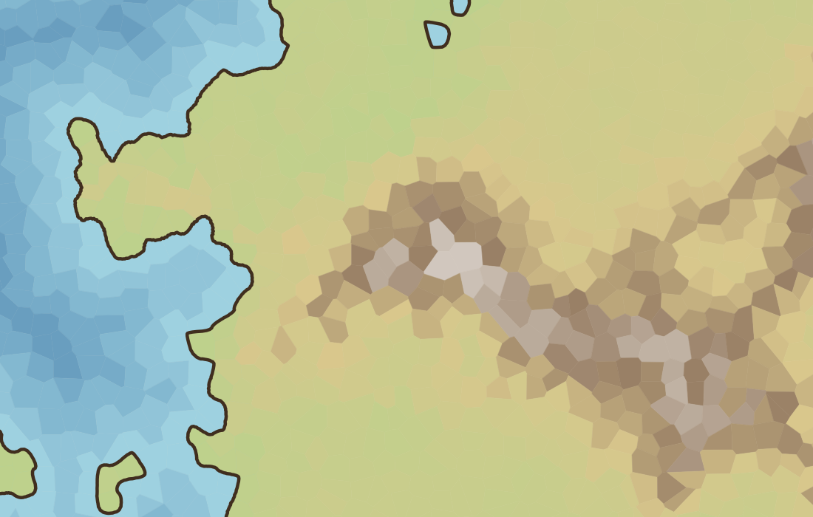

# Drawing stage 2c, step 3: roughening integrated, validated, with a fallback

Status: built 2026-10-20; review corrections applied (see the last section) (plan: [roughening-2c.md](../plans/roughening-2c.md)). Roughening is **off by default**.

## What was built

- **A narrow validated surface in the core** (`Sources/FantasyMapKit/Coast/Roughening.swift`); the raw kernel stays internal. `RoughnessSettings` (the original's knobs in absolute map units, **with one documented departure: `baseAmplitude` defaults to 0.75, not the original's 1.5**; `Codable`) with `validate()`: every value finite and in range, depth 0 to `Roughening.maximumDepth` (6), settings outside the limits are **refused, not clamped**. `Roughening.worstCaseOutput` (closed: n × 2^depth points; open: (n − 1) × 2^depth + 1; plus the n stored indices) by overflow-checked arithmetic. `Roughening.displace` validates settings, size and coordinates (finite, within 1e9) and refuses a chain over its budget **before allocating**. `Roughening.seed(mapSeed:variant:)` is this package's **map-level integration policy**, separate from the original's per-feature seed that the fixtures test.
- **Integration in `CoastOutlines`** (`CoastOutlines(map:smoothing:roughness:)`, `MapStyle.roughness`, nil = off): after smoothing, before frame closure, so fills and ink stay one boundary. Open coast pieces use the open-chain path (ends kept, never closed); closed loops use the closed path, and **a loop with negative area (enclosed water) takes the lake multiplier** (this package's convention, distinct from the original's feature classification; documented on `CoastOutlines`, not on `RoughnessSettings`, which only describes the multiplier).
- **Bounds and checks, in order:** valid settings; the worst case over **all outlines of the drawing** within one million points (a policy, not a performance guarantee), counted with the stored indices, else refused as a whole; a **total** displacement bound of 0.1 grid spacing from the smoothed input segment each point came from (points pulled back to it; a trial value, not a guarantee), then clamping into the rectangle; finite coordinates; frame closure consistent; no repeated point and no ink along the frame; **no crossings or topology-breaking contacts** (see the corrections below), found with a uniform grid and a work budget of 20 million operations in which **every candidate visit is charged** (over budget falls back); and a **sampled colour-support check**: every output point and segment midpoint must lie in a cell that touches the other kind, the only cells that have the borrowed colours (`exposed`, `receded`) that paint the changed strip. Samples in supported cells do not prove that a whole segment or the whole strip is covered.
- **Fallback:** if any check fails, the whole drawing uses the validated smoothed outline, `CoastOutlines.roughness` says `.fellBack(reason)` (invalid settings, output budget, non-finite, frame closure, degenerate geometry, crossings, validation budget, colour support), and the result is exactly the smoothed outline. **Settings are never reduced silently until something passes.**

## Tests

Core `RougheningTests` (5): defaults, refusal of every out-of-range value, exact worst-case counts and overflow (and that the real output never exceeds the bound at every depth, open and closed), budget and input validation before work, the lake shore and the seed policy. Drawing (`CoastOutlinesTests`, now 40): off by default and off equals the smoothed outline exactly; on ten maps three setting sets each either pass every check or equal the smoothed outline with a reason; an applied coast keeps its ends on the frame, stays inside the map and inks only the boundary (land left, water right); the displacement bound and the clamp on a chain with an amplitude of 1000 (every inserted point within the cap, original vertices unmoved), open and closed; **strict land/water colour in the changed strip** between the smoothed and the roughened outline on the maps where it applied; same inputs give the same coast, a variant reshuffles it and variant 0 restores it, another map seed differs; invalid settings and an oversized output fall back; the crossing counter finds crossings, equals brute force on 30 random sets of rings, and gives up on its budget; colour support refused in a cell with no other-kind neighbour and granted along a coast; degenerate geometry detected; a style with roughness round-trips through JSON.

## What was found

- **At the original's own amplitude (1.5) the fallback is common, which is why this package defaults to 0.75.** On 15 realistic maps (five templates, three seeds, 1280×800, 10,000 cells, smoothed twice), the original's defaults applied on 4 and fell back on crossings on 11. At amplitude 0.75 and 0.4 all 15 applied. The cause is plausible and not proven: smoothing makes the edges short (about a quarter of a cell edge), and the original's displacement scales with the square root of an edge's length, so on short edges the displacement is large compared to the edge. A single crossing anywhere sends the whole map back to the smoothed outline, which the review chose; **a per-ring fallback would apply more often** and is a possible later step.
- At amplitude 0.75 the roughening is visible as fine wiggles on the coast (see the crop), subtle rather than hand-drawn. The look is judged by eye on one map.
- 10,000-cell maps at depth 6 and smoothing 2 can pass the budget (about 0.2 million worst case); a 100,000-cell map at depth 6 and smoothing 2 (about 3.2 million) is refused, tested.

## Limits

- Evidence is on ten small test maps and 15 realistic ones; the crossing and colour checks are sample-based on top of exhaustive crossing detection per drawing. A passing drawing has no crossing among its rings by the grid check (tested against brute force), not by proof.
- The 0.1-spacing bound is a trial value; nothing here claims it is right for any look.
- Speed was not measured; the debug drawing suite takes about 75 s because of the large-map and crossing tests.
- The view's drawing speed at 100,000 cells with the clip and the borrowed fills is still unmeasured.

## Review corrections (applied after the first version of this step)

1. **Every pair visit is charged to the crossing-check budget.** The charge used to come after the "first bucket both occupy" rule, so a pair met again in other buckets escaped it. A regression (40 long segments sharing about 300 buckets, budget 20,000) fails with the old order and gives up with the new; checked by moving the charge back.
2. **Colour support covers the whole outline.** The old check (`zip(outline, outline.dropFirst())`) missed an open chain's last end and a closed loop's closing segment; the open/closed distinction is now carried into it. Regression cases built from a real map: an open chain whose last end is in a cell with no other-kind neighbour is refused; a run of boundary cells around such a cell passes as an open chain and is refused as a loop because the closing segment crosses it. Both fail under the old code (checked).
3. **Contacts that break a simple outline are refused, not only proper crossings** (`conflictCount`): non-adjacent segments that touch (a vertex on an edge, a repeated non-consecutive vertex) or overlap collinearly, within or between rings (as clamping to the frame can create), and adjacent edges that backtrack over each other; adjacent edges may share their end point. Found with ordinary Double arithmetic and exact-zero comparisons (no tolerance, but intermediate results still round, so these are not robust exact predicates), so a near miss passes: conservative against exact contacts, not a clearance guarantee. Focused cases only: simple rings (a square, a concave L, nested, separate) pass; each contact kind is refused; collinear continuation is fine; a proper crossing still counts.
4. **Default amplitude 0.75** for this package's roughening (off by default); the original's 1.5 stays in the parity kernel and fixtures.
5. **Strict colour test, stated precisely.** With the 0.75 default fewer points leave the smoothed line, so the changed-strip test now renders at 4 pixels per unit and excludes only one output pixel (0.25 unit) around the outline: 1,082 strip samples on ten maps. One sample (11% paper bleeding through at an anti-aliased seam between two water-coloured polygons, 1.15 pixels from the outline) read 0.8 on the blue channel; the test uses 0.7 as a **provisional colour-classification tolerance**, not as evidence of complete coverage: a pixel that is partly paper-coloured can still exceed 0.7, and that the one marginal reading was anti-aliasing at a seam is a reading of one sample, not established. **The seam is kept as a recorded rendering defect.** The marginal readings (between 0.7 and 0.8) are an **asserted allowance of at most 0.5% of the strip samples** (one of 1,082 observed), so a later change cannot add many dim seams unnoticed. Cells are deliberately not enlarged to hide it (overlaps change colours and transparency); an anti-aliasing-disabled diagnostic render would separate geometric gaps from raster seams when the renderer is investigated. Sampled evidence, not a coverage proof.
6. The final debug run of the drawing tests, missing from the first report, was done: debug 55 drawing tests pass in about 140 s, release in about 1 s.

Left for later, as the review said: per-ring fallback (a mixed result must pass global intersection, nesting, frame-closure and colour checks, and open pieces take part in frame-closed rings, so they are not always independent units); the view's speed at 100,000 cells, to be measured **before** per-ring fallback so there is a baseline.
